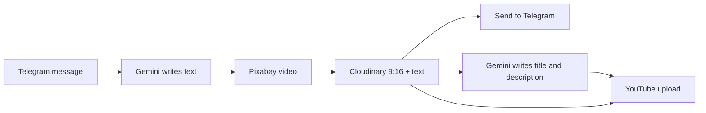

<h1 align="center">🎬 YouTube Content Automation</h1>

  Send an idea on Telegram → get a ready-to-post YouTube Short. 
  Built with <b>n8n</b>, <b>Gemini</b>, <b>Pixabay</b> and <b>Cloudinary</b>.

  
  
  
  

  

---

## ✨ What it does

You message your Telegram bot a topic. The workflow then:

1. ✍️ Writes the video text and the YouTube title/description using Gemini
2. 🎞️ Finds a matching stock video on Pixabay
3. 📱 Converts it to vertical 1080×1920 and adds the text (Cloudinary)
4. 📩 Sends the finished video back to you on Telegram
5. 🚀 Uploads it to YouTube as a Short

## 🔄 Flow

## 🧰 You will need

| Tool | Used for |
|------|----------|
| [n8n](https://n8n.io) | Running the workflow |
| Telegram bot token ([@BotFather](https://t.me/BotFather)) | Input and preview |
| [Gemini API key](https://aistudio.google.com/) | Text, title, description |
| [Pixabay API key](https://pixabay.com/api/docs/) | Stock videos |
| [Cloudinary](https://cloudinary.com/) account | Resize and text overlay |
| Google Cloud project with YouTube Data API v3 | Uploading |

## ⚡ Quick start

1. Import `workflow.json` in n8n (**Workflows → Import from file**).
2. Add your credentials: Telegram, Gemini, YouTube OAuth2.
3. Put your Pixabay key in **HTTP Request** and your Cloudinary details in **HTTP Request1**.
4. In the **YouTube** node, choose a category and keep the binary field as `data`.
5. Activate the workflow and message your bot, for example: `motivation for developers`.

## 🛠️ Common problems

| Problem | Fix |
|---------|-----|
| `Quota exceeded for 'Video Uploads'` | YouTube's daily limit is reached. Wait for the reset (midnight Pacific Time), or request a quota increase in Google Cloud. |
| Category shows "Error fetching options" | Same quota issue or expired login. Reconnect the YouTube credential. |
| Missing binary data | Make sure the Merge output has the video and the YouTube node uses `data`. |
| Video not ready | Increase the **Wait** node time. |

## 🗺️ Roadmap

- [ ] Voice-over with text-to-speech
- [ ] Background music
- [ ] Approve on Telegram before publishing
- [ ] Retry on failed uploads

## 🤝 Contributing

Pull requests are welcome. For big changes, please open an issue first.

---

Made by <a href="https://github.com/your-username">Kajal Khandekar</a>

